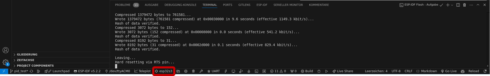
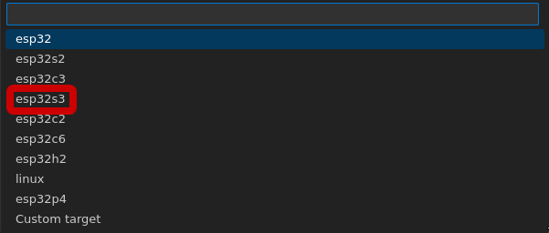
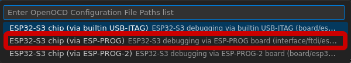
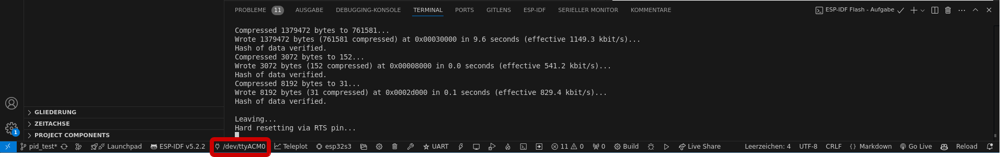
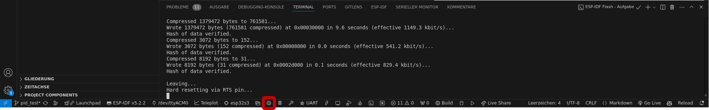
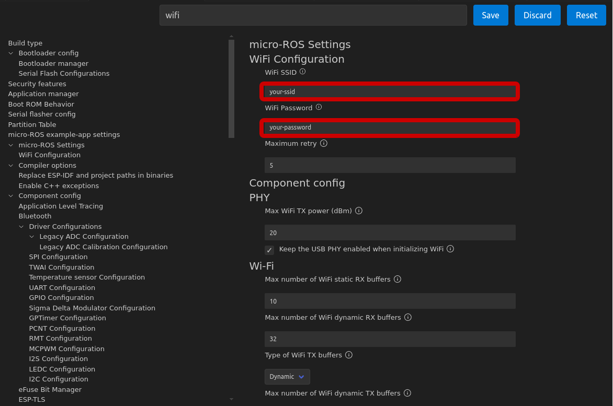
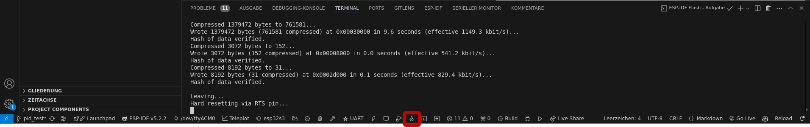

# EduRob V2 

## Install 
#### 1. Install ESP-IDF via the Extension in Visual Studio Code. Todo so follow the [README](https://github.com/espressif/vscode-esp-idf-extension/blob/master/README.md) Guide (The Code has been tested with ESP-IDF v5.2.2) 
#### 2. Clone the repository and open it in Visual Studio Code. The ESP-IDF extension will automatically detect the ESP-IDF and configure the project. 
#### 3. Choose the **eps32s3** as the Builttarget.

1. 
2. 
3. 
#### 4. Choose the right COM-Port, so ESP-IDF can flash the code to the ESP32 S3. 
1. 
#### 5. Enter the WiFi SSID and Password in the SDK Configuration. 
1. 
2. 
#### 6. Build and Flash the Code to the ESP32 S3. 
1. 
    

## Usage

## Components

### micro_ros_espidf_component
For using the EduRob with ROS 2 the micro-ros component is needed. 
The micro-ros component can only be built if a ROS 2 distribution is installed on the device that builds the component. 
In order to be able to develop software for the EduRob without having to have a ROS 2 distribution installed on your system, the micro-ros component is integrated into the project pre-built. 
In the micro-ros component folder you can find the pre-compiled *libmicroros.a* binary. It is build on a Ubuntu 22.04 with ROS 2 Humble for the ESP32 S3. 
This component is marked as pre-build in the *CMakeLists.txt* in the main folder so that you can use the micro-ros component as usual without having to worry about building micro-ros on your own system.  
In order to compile the micro-ros yourself, you simply need to adapt the CMakeList.txt in the main folder accordingly.

### 

