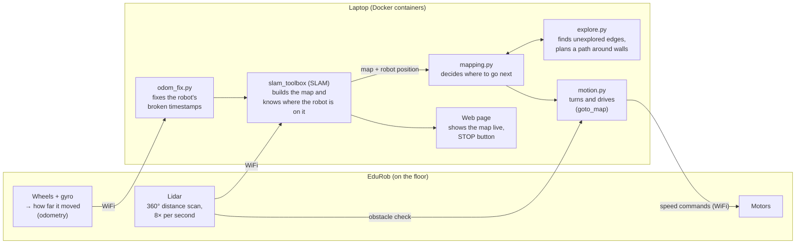
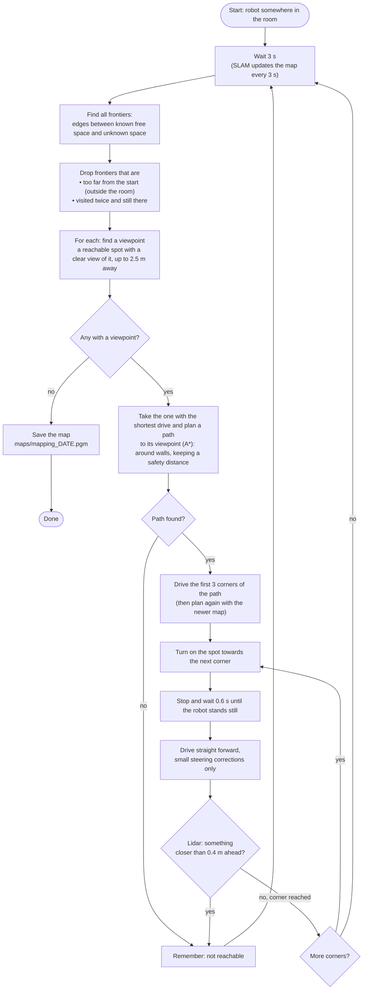

# Autonomous mapping with the EduRob

The EduRob is put into a room (about 5 × 11.5 m) with an obstacle course built from walls
(about 3 × 3 m). Somewhere inside the course is a barrel that will have to be grabbed later.
Before that, the robot has to find out **what the course looks like**: it drives around by itself
and draws a map of the walls, outside and, where it can get in, inside.

`scripts/mapping.py` does that. This page explains how, without assuming any knowledge of the project.

## In one sentence

The robot keeps driving to the **nearest place where its map ends** and looks around there, until
there is no such place left that it can reach.

## The pieces



- **Odometry**: the robot counts wheel turns and uses its gyro to know how far it has moved.
  That drifts over time (wheels slip).
- **Lidar**: a spinning laser that measures the distance to everything around it.
- **SLAM** (Simultaneous Localization And Mapping, here `slam_toolbox`): combines both. It matches
  every lidar scan against the map built so far, which corrects the drift and makes the map grow.
  The result is a grid map: every 1 × 1 cm cell is **free**, **wall** or **unknown**.

## What mapping.py does, step by step



### What is a frontier?

```
  ? ? ? ? ? ? ? ?        ? = unknown (not seen yet)
  ? ? ? F F F ? ?        . = free floor
  ? ? F . . . F ?        # = wall
  # # . . R . . #        F = frontier: free, right next to unknown
  #   . . . . . #        R = robot
  # # # # # # # #
```

The lidar can't see through walls, so everything behind a wall stays unknown. Free cells next to
unknown ones are the frontiers.

The robot doesn't have to drive *onto* a frontier, it only has to **see** it. For every frontier the
planner looks for a **viewpoint**: a spot the robot can reach, with nothing but free floor between it
and the frontier, up to 2.5 m away, as close as possible. That matters for the obstacle course: its
narrow corners and dead ends are often too tight for the robot, but it can look into them from the
entrance. (The first version required the robot to stand right at the frontier, so it never looked
into the course at all.) A frontier that is still there after two visits can't be seen from anywhere
reachable and is left out. In a 5 × 11.5 m
room the lidar (range 12 m) sees almost the whole room right away. What's left are mostly the
shadows behind the course walls, so the robot ends up exploring **the course**, outside and in.

### How the path is planned

The 1 cm map is coarsened to 5 cm cells (fast enough to plan in a few hundredths of a second), then:

1. The map is cleaned of single noise points, then for every spot the **exact distance to the nearest
   wall** is computed (on the 1 cm map, so a 40 cm passage really stays 40 cm). The robot is
   26 × 18 cm and only turns on the spot or drives straight, so two sizes matter:
   - **driving**: half its width (9 cm) + 6 cm margin must be free → passages from **0.30 m** are open
   - **turning**: the circle its corners sweep (16 cm) + 2 cm must be free → the robot only turns
     (path corners, viewpoints) where there is room for that
2. **A\*** (a standard shortest-path search) finds the shortest way through the remaining free cells.
   Cells close to a wall (< 0.5 m) count 3× as long, so the robot prefers the middle of passages.
3. The path is reduced to its **corners**: the robot drives straight lines between them.

Unknown space is never planned through: the robot only drives where the map says it's free.

### Why it only turns and drives forward

The EduRob has mecanum wheels and could also drive sideways. But sideways driving slips the most,
the odometry gets wrong, and a wrong odometry smears the map. Turning on the spot and driving straight
forward slip the least. Also measured on this robot, and built into the motion code:

| Limit | Value | What the code does about it |
|---|---|---|
| Commands the robot accepts over WiFi | ~2 per second | sends at most every 0.5 s |
| Delay command → movement → position known | ~0.6 s | predicts the position 0.6 s ahead; stops and waits 0.6 s between turning and driving |
| Fastest wheel speed | ~0.16 m/s | scales every command down to that |
| Lidar vs. odometry timing | 0.04 s apart (measured) | `odom_fix.py` corrects for it |

While driving, the lidar watches the robot's actual footprint: it stops if anything is in the strip
its 18 cm wide body will sweep in the next 20 cm (+ 3 cm on each side), and it doesn't turn if anything
is inside its turning circle. If it is too close to something to turn, it backs up 10 cm first.

Speed while mapping: 0.12 m/s forward, 25 °/s turning. Measured accuracy of a single move
(turn + 40 cm forward on the map): 3–7 cm, heading within ~6°.

## How to run it

```bash
./start.sh --slam        # robot connection, lidar, SLAM, web page (prints the address)
```

Then in the web page: pick `mapping.py`, press **Run**, keep **STOP** at hand. The map grows live in
the page. When it's done, the map is saved as `maps/mapping_<date>.pgm` + `.yaml`.

Settings at the top of `scripts/mapping.py`:

| Setting | Default | Meaning |
|---|---|---|
| `ROBOT_LENGTH`, `ROBOT_WIDTH`, `LIDAR_X` | 0.26 m, 0.18 m, 0 | the robot's size and where the lidar sits (0 = centre) |
| `PLAN_MARGIN` | 0.06 m | planned paths keep this much between the robot's side and walls |
| `TURN_CLEARANCE` | 0.02 m | free space around the turning circle |
| `DRIVE_CLEARANCE`, `LOOK_AHEAD` | 0.03 m, 0.20 m | live lidar check: beside / in front of the robot |
| `DRIVE` | `True` | `False`: only plan and print the first target, the robot doesn't move. Use this first. |
| `SPEED`, `TURN` | 0.12 m/s, 25 °/s | slower = cleaner map |
| `MAX_RANGE` | 7 m | frontiers farther from the start are ignored (so it doesn't leave the room through a door) |
| `WAYPOINTS_PER_PLAN` | 3 | corners driven before planning again |
| `MAX_ROUNDS` | 60 | safety limit |

Planning settings (robot size, margin, grid size) are at the top of `explore.py`.

### Checking the planner without the robot

```bash
./ros.sh python3 explore.py maps/barrel.yaml             # start = map position (0, 0)
./ros.sh python3 explore.py maps/barrel.yaml 1.4 0.2     # start somewhere else
```

writes `maps/barrel_plan.png`: white free, black wall, pink too close to a wall, grey unknown,
blue frontiers, green chosen target, red path, orange start.

## Status and limits

| Tested | Result |
|---|---|
| Planning offline on all saved maps | sensible frontiers and paths, 0.01–0.06 s per plan |
| `goto_map` on the robot (turn + drive forward) | arrives within 3–7 cm, refuses to drive into an obstacle |
| First full autonomous run (`maps/1stmap.pgm`) | room mapped cleanly in 9 rounds, but it never looked into the course: frontiers there were dropped because the robot couldn't stand on them, and the robot size was overestimated (0.25 instead of 0.16 m). Fixed with viewpoints + real size |
| Viewpoints on `1stmap` (offline) | 22 frontiers, 15 with a viewpoint; path into the course channel found; chamber looked into from the channel |
| Second run (robot size 0.25 m → 0.16 m) | drove between chairs and into obstacles: the stop check ignored the robot's width, the planning margin was too small. Fixed with the footprint check and exact wall distances |

Known limits:
- Passages narrower than 0.30 m are treated as closed: the robot looks into them from outside
  (up to 2.5 m) but doesn't drive in. Lower `PLAN_MARGIN` in `mapping.py` carefully if needed.
- In `1stmap` the course is a funnel: a 40 cm channel (35 cm at the end) into a ~0.9 × 0.8 m chamber.
  An object sits right in the chamber entrance (at about (−0.6, 0.2) on that map, maybe the barrel),
  leaving two gaps under 15 cm: the robot drives into the channel and looks into the chamber, but
  doesn't drive into it.
- A closed course (no entrance) can only be seen from outside, as far as the lidar reaches over or
  through gaps.
- Map quality depends on the start: a fresh SLAM map gives the best result
  (*New map* button in the web page before starting).
- The robot's firmware sends broken timestamps; `odom_fix.py` works around it. A firmware fix would be
  cleaner.

## Next: the barrel

The barrel (≈ 7 cm diameter) shows up in the lidar as a small arc of points. Plan: group lidar points
into clusters, fit a circle to each, keep circles with ~3.5 cm radius, and report their position on
the map. That can run during mapping, so the robot already knows where the barrel is when it's done.

## Files

| File | Role |
|---|---|
| `scripts/mapping.py` | the exploration loop (this page) |
| `explore.py` | frontiers, safety margin, A* path planning (numpy, no ROS) |
| `motion.py` | `get_map_pose()`, `goto_map()` and all other movement functions |
| `edurobot.py` | ROS connection: odometry, lidar, sending commands with the robot's limits |
| `odom_fix.py`, `slam_params.yaml`, `slam.Dockerfile` | SLAM setup (`./start.sh --slam`) |
